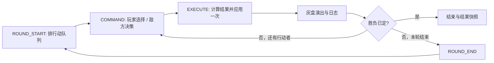

# M1 战斗灰盒开发计划

> 版本：v0.4（A/B/C/D 灰盒已实现，D 待用户体验反馈）
> 日期：2026-09-30
> 当前基准：M0 `7f88b2c`、M1-A `5813c2f`、M1-B `a6b1cf8`、M1-C `3d59c07` 已保存
> 本轮工作：用户确认B/C试玩无问题后，完成M1-D；验证结果见 [M1验收记录](M1验收记录.md)

## 1. 目标与依据

M1 的目标是让《新海风云》的核心战斗规则在灰盒中可玩、可调参、可复现，并连续跑通“后山野兔”三段教程。

| 来源 | 本阶段采用的内容 |
|---|---|
| [AGENTS.md](../../AGENTS.md) | 文件职责、静态类型、资源与 UID 约束、设定查证与文档同步 |
| [策划案 v0.4.2](../../策划与剧情/觉醒者档案新海风云策划案_v0.4.md) §5、§11.3 | 指令回合制；属性、克制、HP/SL、冷却、临阵突破；M1 验收判据 |
| [剧情卷 v0.3](../../策划与剧情/觉醒者档案新海风云_剧情卷_v0.3.md) 第1章 | 林大、苏挽颜委托、野兔群→技能与 SL→野兔王三段教程 |
| 世界书 001/002/004/005/056/057 | 等级、五系、代价与环境的世界观基础 |
| [033 温让](../../世界观与人物设定/033_温让.txt)、[059 苏挽颜](../../世界观与人物设定/059_苏挽颜.txt) | 具名角色的身份、等级、能力与言行依据 |
| [M0 工程约定](M0开发计划.md) | 分辨率、渲染器、工程布局与已有测试方式 |

当前进度以工程及各批验收记录为准。M0、M1-A/B/C/D 已完成灰盒与引擎检查，后山三段可连续运行；M1的四项工程判据已有证据，教程的人类试玩节奏与数值平衡仍待反馈。

采用游戏策划已经明确的改编规则：**HP + SL，无 MP；伤害公式采用 JRPG 数值公式；临阵突破采用战斗临界槽和本场增益。** 世界书原有的 DC、灵能值消耗与战中永久升级属于原卡机制，不能直接复制进游戏实现。世界书中的角色身份与异能事实继续有效。

## 2. M1 的范围

### 必须完成

- 指令式回合战斗，按 SPD 排序；敌我共用一个 `Combatant` 场景和同一套结算规则。
- 属性、命中与伤害、五系克制、等级压制；环境修正可由遭遇数据配置。
- HP/SL、技能冷却、SL 阈值与失控、战斗临界槽与临阵突破。
- 战斗指令与目标选择、最小敌方 AI、胜负判定、重试。
- 可导出战斗日志；固定随机种子可重跑同一战斗。
- 三段野兔教程；灰盒方块与简单演出；数值外置。

### 后续阶段接入

| 内容 | 安排 |
|---|---|
| 正式人物、地图与技能特效美术 | M1.5 验证管线，M2 开始替换 |
| 入学、拜山、好感邀约、任务与日历 | M2 垂直切片 |
| 永久等级突破、技能熟练度成长、装备与背包经济 | 与养成系统分批接入 |
| 完整换排收益、道具指令、复杂控制状态 | 后续战斗扩展批次，先明确对应规则 |
| 连携与专属连携演出 | M3；M1 用“换目标、降压、突破”满足三类决策验收 |

前后排作为站位数据和布局参考；M1 不自行增加战棋格、移动点或地形寻路规则。

## 3. 四个开发批次

每批顺序为：列出当批改动 → 实现 → 引擎与画面验证 → 保存可运行提交 → 用户体验反馈。B/C已分别验证、保存并由用户试玩；本次用户授权D，完成后交付，下一阶段M1.5另行开始。

### M1-A：最小战斗闭环（已实现）

**交付：一个独立可运行的 1 对 1 战斗场景。**

1. 新建 `BattleSandbox`，沿用 M0 的 960×540 世界和 1920×1080 UI 约定。
2. 一个通用 `Combatant` 场景，分别加载测试主角与测试敌人的数据。探索用 `Player` 保持四向移动职责。
3. 实现 SPD 行动队列、【攻击】【防御】、敌方普攻、倒地、胜利/失败、重新开始。
4. 普攻使用策划 §5.4 的公式结构；本批遭遇设置为同等级、普通环境、无克制，修正均为 ×1。
5. 防御实现策划明确的 **SL -15、回复 HP 上限的 10%**。测试预设可带初始伤势与 SL，以便看出效果；这属于测试开场配置。
6. HP/SL、当前行动者、行动顺序与战斗日志在 HUD 中可见；输入被接受后锁定命令，防止重复结算。
7. 基础属性与规则外置；日志记录种子、行动与每次状态变化。

**当批验收：**

- 能从开场连续打到胜利或失败，并重试；倒地单位不再行动。
- 防御回复不超过 HP 上限，SL 不低于 0；攻击不会把负伤害当治疗。
- 连续点击不能多打一次；同种子、同输入的日志结果一致。
- 两个单位的运行状态互不污染，原始 `.tres` 数据不被战斗改写。
- 改一个外置数值，下一次开战即生效；原 M0 移动与画面验收仍通过。

**范围边界：** 独立选中战斗场景按 F6 运行；M0 原有 F5 入口保留。技能、克制、失控、突破和剧情串联从后续批次加入。

### M1-B：技能、克制与精神负荷（已实现）

**交付：能换目标、选择技能、观察冷却与负荷后果的多单位战斗。**

- 技能表包含倍率、系别、目标类型、SL 增幅、冷却；先做少量单体技能与一个多目标样例。
- 实现四系克制环及特殊系中性关系；目标预览显示克制信息。
- 实现同级/等级差 1、2、3 及以上的修正，以及可配置环境修正。
- 实现 SL 50/70/85/100 的规则，包含技能偏离和觉醒失控。
- 敌方采用简单、可查明原因的合法指令选择：技能可用时施放、负荷过高时降压，其余普攻。
- 运行配置可切换测试主角的系别和技能，用于规则实验；正式主角的出生系别与拜山结果在 M2 接入。

**当批验收：**

- 命中/未命中、克制/被克/中性、各等级差与各 SL 阈值有边界测试。
- 技能 CD=0 可选、CD>0 禁用，扣减时点与实际可再用时点一致。
- 同一行动的 SL、冷却、伤害只结算一次；多目标技能不会按命中人数重复收费。
- 偏离和失控可以用固定种子重现；目标过滤正确，不攻击已倒地单位。
- 多单位行动中，前一个目标倒地后，后续指令按已确认的目标失效规则处理。

### M1-C：临阵突破与通用同伴验证（已实现）

**交付：可测试成功、失败、保底和临时增益的突破机制。**

- 实现临界槽积累、满槽解锁、突破成功率明示。
- 成功：本场全属性 ×1.3、SL 清零、HP 回复 50%。
- 失败：SL +25、临界槽回落至 50、1 回合虚弱；按策划增加再尝试的成功率。
- 临界槽是突破触发计数；不作为新增施法消耗资源。
- 在独立沙盒中加载温让的同伴配置，验证 **C 级、强化系·防御** 的角色事实与同一 `Combatant` 模板兼容。
- 温让配置用于加载/队伍验证；其正式入队节点和后山教程队伍由 M2 剧情接入。

**当批验收：**

- 临界槽不足时不可突破，成功率与实际抽样规则一致。
- 成功、失败、虚弱结束、保底上限均可复现；临时增益不会写回角色原始数据。
- 同一 `Combatant.tscn` 能用敌人表和同伴表各跑通一场；没有按人物名写死的结算分支。
- 一场专门的决策验证遭遇中，实际产生 **换目标、防御降压、临阵突破** 三类行为，并能从日志解释选择依据与结果。

### M1-D：三段教程与整体验收（已实现）

**交付：连续可玩的“后山野兔”战斗灰盒。**

| 段落 | 玩法重点 | 演示结果 |
|---|---|---|
| 1. 野兔群 | 普攻、行动顺序、目标与克制识别 | 看懂谁先行动、该攻击谁 |
| 2. 技能上手 | 技能强度、SL 增幅、冷却 | 能比较普攻和技能的成本 |
| 3. 野兔王 | 防御降压与资源规划 | 能用已知信息完成小 Boss 战 |

- 林大与野兔/野兔王的具体战斗参数建立为游戏测试配表，标明“灰盒待调”。世界书异兽图鉴未定义这些野兔的等级或系别，不能拿其他异兽配置冒充。
- 苏挽颜依剧情在入口旁观指点；她的 **B 级、冰系、青梅学姐** 设定保持一致。教程使用短提示和必要台词。
- 三段之间连续携带HP/SL，临时状态清理，重试恢复本段开场检查点；观察项仅作提示，可隐藏，不限制合法指令。
- 增加明确的灰盒测试入口与返回/重试操作；完整后山地图、委托任务、日历时间结算留待 M2。
- 战斗流程结束或返回时断开输入、信号和演出等待，确保重新进入不会重复执行旧回调。

入口为 `scenes/battle/back_hill_tutorial.tscn`，教程/段落/遭遇/单位表位于 `data/battle/tutorial/`。使用 `TutorialDefinition`、`TutorialLesson`、`TutorialSandbox`和`TutorialHUD`复用原结算与显示层；短台词、提示和段落路径均外置。苏挽颜作为入口旁观者，林大独战；第一段SL45用于阈值测试，人物与野兔属性仍为原型表。详见 [D实施补充](../../策划与剧情/M1-D后山教程实施补充.md)。

**当批验收：**

- 从第一段走到野兔王，无卡死、错误强制入队或重复奖励/结算。
- 新手可完成三段，熟悉规则后可以跳过提示重玩；提示不会永久锁死可选指令。
- 配表、日志、同伴/敌人复用、三类决策四项 M1 主判据全部通过。
- 实际试玩检查耗时与决策质量；不能只用自动战斗胜率代替体验验收。

## 4. 工程设计

当前 `main.gd` 绑定 `AcademyGraybox/Actors/Player` 和探索诊断 UI。首批新增独立战斗装配场景，沿用显示约定；不把回合状态塞进探索移动脚本，也不在本阶段大幅重构现有主场景。

| 模块 | 职责 | 开始批次 |
|---|---|---|
| `CombatantDefinition` / `.tres` | 身份、等级、系别、基础属性与测试战斗属性 | A |
| `BattleRules` / `.tres` | 伤害系数、资源边界、后续 SL/CD/突破规则参数 | A，字段随批次补充 |
| `EncounterDefinition` / `.tres` | 双方配置、环境、开场状态与测试种子 | A |
| `CombatantState` | 每个实例独立的 HP/SL；后续 CD、临界槽与状态 | A |
| `BattleController` | 回合状态机、行动队列、合法指令、胜负与日志 | A |
| `BattleCalculator` | 可单独测试的命中、伤害与状态计算 | A |
| `Combatant.tscn` | 敌我共用的灰盒呈现节点 | A |
| `BattleHUD` | 命令、目标、双方状态、信息提示与结果展示 | A |
| `SkillDefinition` / `.tres` | 技能数据 | B |
| `TutorialDefinition` / `TutorialLesson` | 外置教程身份、短台词、提示、观察项与遭遇路径 | D |
| `TutorialSandbox` / `TutorialHUD` | 三段流程、检查点、HP/SL携带、可选提示与整段日志 | D |

定义数据与运行状态分离：每次开战创建独立状态，保存/日志只导出普通数据快照。HP/SL 在教程连续战中有明确的输入和输出，便于 M2 接入角色持久状态。

数值外置包括倍率、骰子范围、克制/等级修正、SL 阈值与增幅、防御回复、CD、突破概率与效果。六维到攻击/防御/SPD等战斗属性的映射尚未定稿，灰盒先使用外置的测试战斗属性；映射明确后再接计算，避免写死推导公式。

结算由控制器执行，UI 只显示状态并发出指令请求。演出等待期间禁止再次提交；表示层结束后才推进队列。信号在 `_ready()` 显式连接。

**首批主要新增路径：**

- `scenes/battle/battle_sandbox.tscn`、`scenes/battle/combatant.tscn`
- `scripts/battle/`：本批用到的控制、结算、状态、HUD 和 Resource 定义
- `data/battle/`：规则、两个单位和一个 1v1 遭遇预设
- `tests/m1_battle_smoke.gd`、`tests/m1_battle_visual.gd`
- `docs/M1验收记录.md`：随批次记录真实验证结果

只创建当批实际使用的模块。已有资源路径和 UID 保持稳定；需要改引擎配置时优先用 Godot 编辑器；`.godot/` 由引擎管理。

## 5. 实现前需明确的规则口径

下表A/B/C/D已作为原型默认口径实现，分别同步到 [A实施补充](../../策划与剧情/M1-A战斗灰盒实施补充.md)、[B/C实施补充](../../策划与剧情/M1-BC战斗灰盒实施补充.md) 与 [D实施补充](../../策划与剧情/M1-D后山教程实施补充.md)，保留后续试玩调整空间。SPI/WIL派生加成及低血/连续战额外概率尚未定稿。

| 批次 | 原稿未明确的点 | 已实现的原型口径 |
|---|---|---|
| A | 全局一轮与角色一次行动的区别 | 一轮按 SPD 让存活单位各行动一次；攻击/防御占该角色一次行动；队列在下一轮重新排序 |
| A | 伤害、回复的取整与最低伤害 | 最终值四舍五入；成功命中最低伤害 1；回复按 HP 上限百分比并封顶；命中率限制在 0–100% |
| A | SPD 同速且 d6 同点 | 同点继续掷骰决胜，所有结果记录到固定种子日志 |
| B | 普攻的克制系别 | 采用攻击者当前系别；技能可在数据中指定自身系别 |
| B | CD 何时扣减，CD=1 意味着什么 | CD=N 阻止该角色接下来 N 次行动使用该技能；在其行动结束时对已有 CD 扣减，刚施放技能的 CD 本次不扣 |
| B | SL 70–84 的“命中 -20% + 额外 -15%”、85–99 是否继承低档惩罚 | 原型采用累计档位：70+ 保留伤害 ×0.8、基础命中 ×0.8 后再减15个百分点；85+ 保留此项并增加偏离，后续依据试玩调参 |
| B | WIL 降 SL、SPI 缩 CD 的具体函数及结算顺序 | 在定稿前测试配置不启用这两项派生加成；先验证基础 SL/CD，随后把已确认函数外置 |
| B/C | 多目标命中的克制返 SL 与临界奖励按目标还是按动作计算 | 按动作收一次SL、返SL2最多一次；技能临界+5与克制临界+15各每动作一次，每个命中受击者独立获得8–12 |
| B | 失控时长、触发时点、随机目标池与目标失效 | 达到100后从下一次角色行动起接管3次行动；随机池包含存活敌我但排除自己；合法目标失效时重新选择，只有成功提交的动作才收费 |
| C | “消耗1整回合”、成功后的临界槽、重复成功和属性映射 | 突破占角色一次行动；成功临界槽清零；本场成功增益只生效一次；不会同时把六维和派生属性重复乘1.3 |
| C | 受击+8–12、低血/连续战概率修正、虚弱时长 | 外置表独立随机受击+8–12；额外成功率修正暂为0；虚弱影响下一次角色行动，保底+15个百分点且最多两次 |
| D | 三段战之间 HP/SL、CD和临界槽如何携带 | HP/SL 连续携带；每场临时战斗状态结束后清理；重试恢复当前段开场快照；不默认加入免费回复事件 |
| D | 临时HP上限与配表重载 | 突破增益结束后携带HP截至基础上限；R重载数值且保留检查点；修改玩家身份/实例/队伍须三段一致并按T从头重玩 |
| D | 提示解除与完成条件 | 战斗胜利即完成段落；观察项只记录反馈；H切换提示，开场与通关页可直接无提示重玩 |

以上实现口径用于灰盒验证，不表示数值平衡或正式配表已定稿。后续确定规则或改变实际游戏数值时，按 `AGENTS.md` 回写策划案相关小节，或在同目录补充文档中记录并由策划案引用。固定种子与特殊测试开场值保留为测试夹具，不回写成世界观事实。

林大的正式系别/初始技能、野兔与兔王的等级/技能/属性表同样需要游戏配表。M1 的实验预设标明测试用途，正式第1章数据在 M2 接入前定稿。

## 6. 验证与停点

| 层级 | 要验证的内容 |
|---|---|
| 规则测试 | 固定种子、伤害/命中边界、HP/SL边界、CD和状态时长、定义数据不变 |
| 引擎流程测试 | 玩家/敌方行动、死者跳过、多目标失效、连点、胜负、重试与重复进入 |
| 实际画面测试 | 三种窗口尺寸、世界整数像素、独立中文 UI、选中状态与行动信息可读 |
| 数值与体验测试 | 同一遭遇的不同策略与种子、教程通过率、实际时长、至少三类有依据的决策 |
| 回归 | M0 原有移动、碰撞、相机与显示测试 |

日志至少包含：遭遇/配表版本、随机种子、全局轮次、行动者、指令、目标、随机抽样、命中/伤害修正、HP/SL/CD/临界槽前后值、胜负。游戏导出到 `user://battle_logs/`；测试报告与画面仍放在 `.dev/`，便于后续打包与重跑。

测试不是要求玩家机械点齐三个按钮：目标选择应体现克制差异，防御应改变下一次行动的负荷代价，突破应在概率和失败后果可见时成为可选策略。

**本次执行停点为 M1-D。** A的1v1、B的多单位技能/负荷、C的突破/同伴/三类决策、D的后山三段教程均已交付。D规则68项、实际窗口47项及20组种子样例通过，M0/A/B/C回归通过；体验时长与平衡须结合用户试玩。M1.5美术管线和M2剧情系统未开始。每批的验收数量与结果以实际运行记录为准。

如果 M1-C 的突破机制阻碍核心验证，采用策划 §11.3 的降级方案，将突破延后，先完成属性/克制/SL/CD；同时明确这是降级交付，修订三类决策验收与阶段记录，不能照原标准宣称完整 M1 通过。
