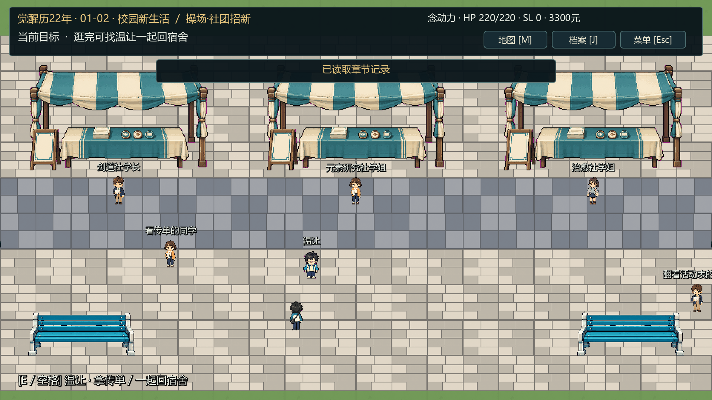
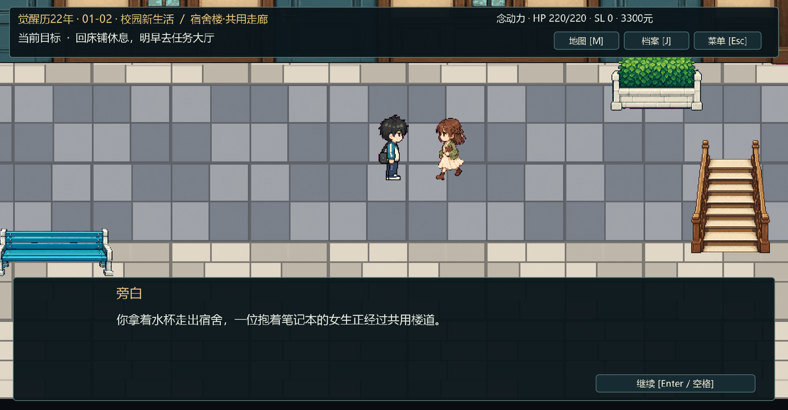
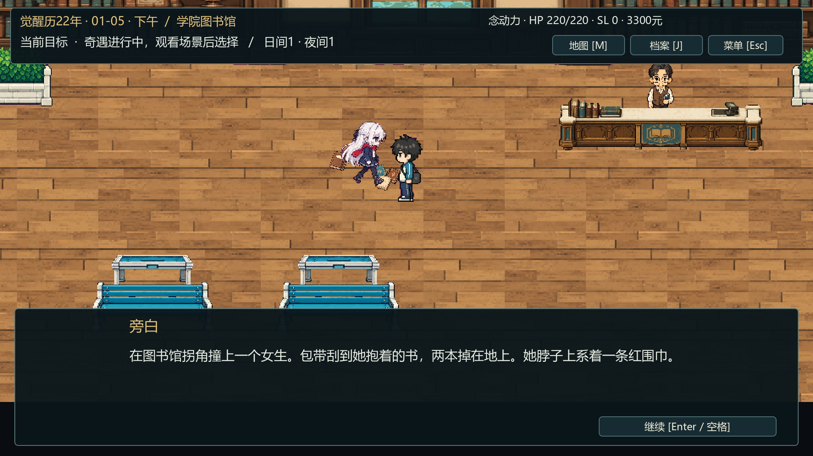
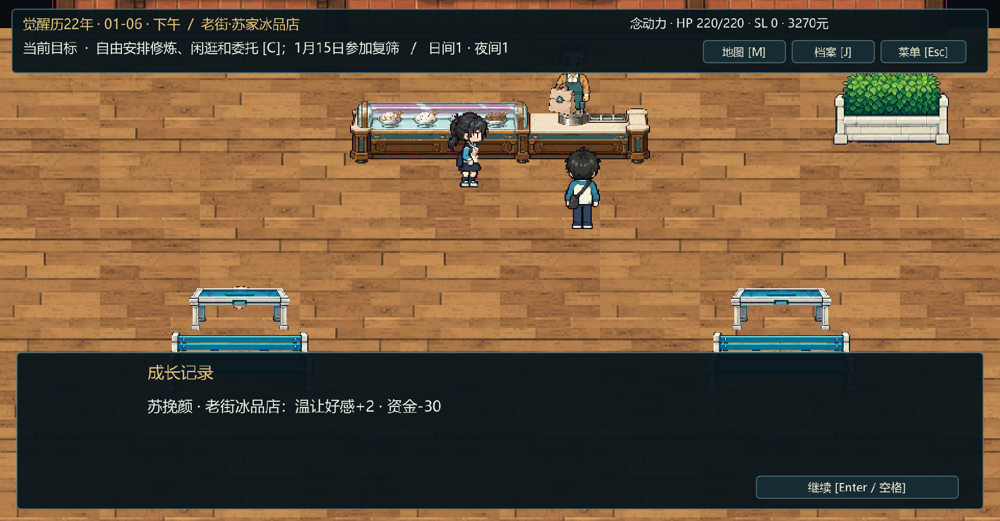
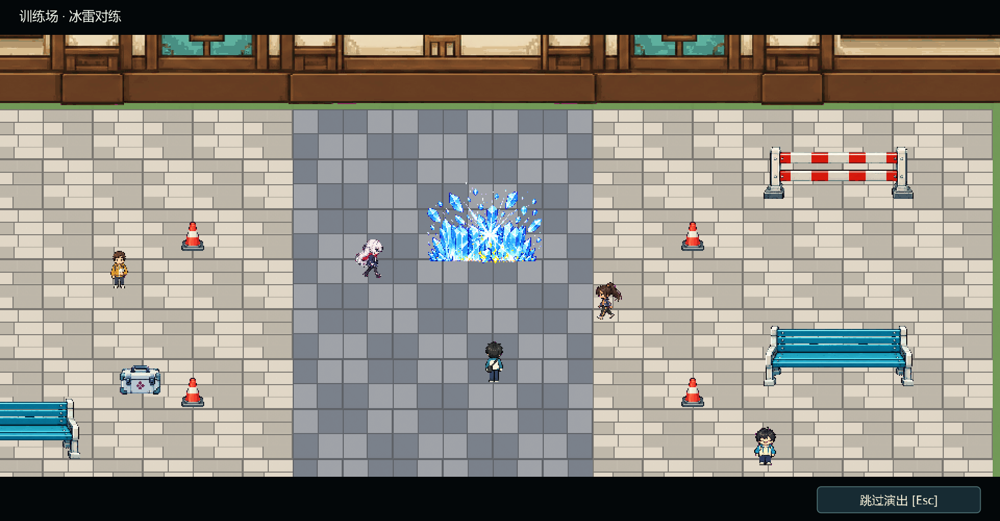
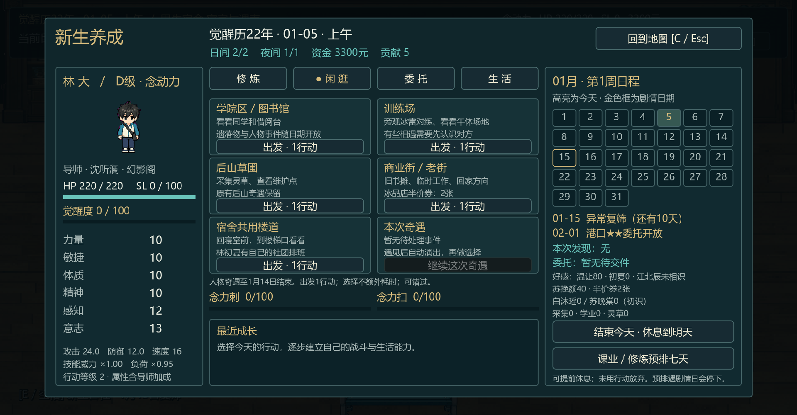

# 人物奇遇、社团招新与宿舍走廊

更新：2026-10-01。Godot 4.7.2 / Compatibility，GTX 1650。依据剧情卷 v0.3.9及用户最新反馈完成本轮实装；首章仍为01-01—01-03，01-04—01-14自由养成，01-15触发第二章。

## 如何体验

1. F5运行工程。首章后山任务结束后，社团招新有剑道、元素研究、治愈三个摊位，均有招新人员、桌台和可交谈内容。逛完找温让，选择一起回宿舍，两人走向出口并淡出转场。这里先了解社团，正式登记仍在养成期/第二章活动室进行。
2. 宿舍内完成温让夜谈和凌未央视频，再到房门按E进入独立共用走廊。林初夏沿楼道走来，与主角照面后离开；回房门按E返回寝室，再到床铺休息。第二章邀请她同行和夜谈也在走廊进行。
3. 首章结束页点“进入自由养成 · 1月4日”，或标题选择“首章完成档 · 从1月4日养成”。按C→闲逛，自行选择地点；符合日期/前置条件时自动进入奇遇地图、播放登场，随后阅读对白并选择处理方式。十一种事件均无需走近按E。最新台词与自动触发专项见[奇遇自动触发与台词修订](奇遇自动触发与台词修订.md)。

### 新增五个人物奇遇

| 事件 | 开放日期 | C面板地点与实际场景 | 主要选项与收益 |
|---|---|---|---|
| 苏挽颜·老街冰品店 | 01-06—01-14 | 商业街→苏家冰品店 | 用半价券坐下吃：券−1、苏挽颜+2、觉醒度+2；付30元给温让带一份：资金−30、温让+2 |
| 白沐瑶·图书馆送书 | 01-05—01-14 | 学院→学院图书馆 | 帮忙送书：课业+4、感知+1、白沐瑶+2；只捡起归还：课业+1、白沐瑶+1 |
| 白沐瑶/苏晚棠·冰雷对练 | 01-10—01-14 | 训练场 | 坦率回答：觉醒度+3、两人各+2；客气回应：两人各+1。已完成送书时有对应回话 |
| 苏晚棠·午休加练 | 01-12—01-14；先完成冰雷对练 | 训练场 | 帮忙计数：敏捷+1、觉醒度+3、苏晚棠+3；留一份饭团：苏晚棠+2 |
| 林初夏·楼道传单 | 01-09—01-14 | 宿舍共用楼道 | 帮忙理好传单：课业+3、感知+1、林初夏+2；只递回一张：课业+1、林初夏+1 |

每次出发闲逛扣1个日间行动点，交谈和选项不另扣。每个事件成功结算一次；“先离开”不计完成，也没有遗漏惩罚，已花的出发行动不返还。新人物事件满足条件时优先出现，完成后仍可遇到原六个事件。白沐瑶/苏晚棠在本阶段关系上限为20；既有温让/苏挽颜/林初夏关系沿用原上限与已获得数值。

半价券来自首章已给出的两张券；券和资金不足时不扣物品、不发收益、不标记完成。01-15之后不再生成这五个人物事件，原六事件及第二章日程继续使用。













预览直接复制Godot GPU截图。全景用于检查布置，正常探索为2倍整数相机；紧凑室内演出保持2倍，首日大会场等大场面沿用1倍演出相机。对白镜头在顶栏与底部文本框之间保留人物站位。

## 场景与演出

寝室和共用走廊拆成独立地图，房门有明确互动和往返落点。寝室布置两张床、桌椅和视频通话物件；走廊有三扇房门、楼梯、长椅与植物。林初夏在走廊活动，寝室保留温让；第二章原有招募条件、排班和好感规则保留。

新增图书馆及苏家冰品店，人物分别站在接待台/柜台后，桌面物件独立定位。午休手机、饭团与外带纸袋使用桌面前景层，避免被桌台遮住。地图由TileMapLayer地表、独立墙体/家具、角色、互动点和碰撞组成，运行时不加载整幅地图预览。

新增11份ImageGen源图、80张运行PNG：三人四向行走48帧及3张运行整表、四名职员/招新人员4帧及1张整表、冰墙/雷电8帧及2张整表、14个独立物件。源图、提示词、哈希与QC保存在[人物奇遇美术目录](../assets/encounters/README.md)。人物硬透明、最近邻采样，脚底锚点与既有角色对齐。

首章现16张地图、11段演出；第二章8张地图、12段演出；养成奇遇16段演出（十一入场、五选择）。角色实际沿路径行走、转身、入场/离场，冰雷对练有独立效果帧，午休有手机提示镜头。Esc跳过会到达同一落点与选择，不提前发奖励。原六事件也补了自动入场走位，日期/条件/收益保持。

## 实测结果

下表人物、养成、第二章主流程已按最新台词与自动触发重跑；未改的首章GPU与首章美术保留前一批次基线。GPU依次运行，使用独立测试存档。

| 检查 | 结果 | 本地报告 |
|---|---|---|
| 五事件两种选择、日期/前置、券/资金、上限、防重、旧档和无效档、寝室/走廊流程 | 161/161 | `.dev/encounters-smoke-report.json` |
| 作者稿19片段/115句同步、11源图/80运行PNG来源与哈希、透明/脚底、互动通路和16段演出路径 | 2196/2196 | `.dev/encounters-assets-report.json` |
| 实际键鼠：招新/宿舍、十一事件自动入场、冰雷、外带、五次读档恢复选项与站位、余额不足、旧待入场档、跳过/离开、UI边界 | 1282/1282；74.954秒 | `.dev/encounters-visual-report.json` |
| 原六事件定义与修改前备份逐项比较 | 6/6完全一致 | `.dev/encounters-original-events-report.json` |
| 首章五系×四导师20条完整流程 / GPU标题到章末 | 210/210、394/394；GPU 112.980秒 | `.dev/chapter1-smoke-report.json`、`chapter1-visual-report.json` |
| 第二章40条完整分支 / GPU养成→复筛→走廊招募→两战→S结算 | 625/625、320/320；GPU 65.692秒 | `.dev/chapter2-smoke-report.json`、`chapter2-visual-report.json` |
| 原养成日期、成长、原六事件与任务 / 面板、送件、15日交接、多窗口 | 81/81、746/746；GPU 27.495秒 | `.dev/cultivation-smoke-report.json`、`cultivation-visual-report.json` |
| 首章既有美术/文本 / 第二章美术、文本与动态事件通路 | 612/612、697/697 | `.dev/chapter1-assets-report.json`、`chapter2-assets-report.json` |
| Godot最终资源导入与脚本注册 | 退出码0，无ERROR/WARNING | `.dev/auto-encounters-import-final.log` |

养成GPU覆盖960×540、1280×720、1920×1080、1000×900和2560×1080，验证五个闲逛卡片、说明/按钮、关系及行囊布局；超出本机屏幕的尺寸为渲染窗口模拟。首章原分辨率专项539/539的历史证据另见[首章验收](第1章验收记录.md)。已查看招新、寝室、走廊、图书馆、冰品店、训练场和面板实际截图。

快速自动输入用于验证运行路径、演出及交互，M2一小时人工连续阅读体验与最终平衡仍待验收。

## 存档与维护

外层仍为`chapter1.1`，日历`chapter2-prototype.2`，成长`cultivation.1`。旧档缺少新人物关系时补0、缺少半价券时补首章已给出的2张；已有数值保留。旧的六事件记录、待交文件、周工作账本和章节日期保持。首章重建后墙内位置回安全入口，第二章已开始的旧档不自动退回01-04。

事件保存ID、房间、完成记录与登场已播放标记；入场结束自动保存待选状态。读档直接显示选项，并恢复入场最终站位，不重播入场；旧待入场存档自动补播。钱券不足提示后保留原选择。选项只结算一次，剧情结果保留至离场演出/对白结束再移除临时角色。无效日期、前置、房间、券数或登场标记会被拒绝。

- 规则事实源：[剧情卷v0.3.9](../../策划与剧情/觉醒者档案新海风云_剧情卷_v0.3.md)、[章节前自由养成实施补充](../../策划与剧情/章节前自由养成实施补充.md)。
- 奇遇台词作者稿：[养成人物奇遇实装台词](../../策划与剧情/养成人物奇遇实装台词_v0.1.md)，19片段/115句；`tools/import_encounter_script.py --apply`先备份再写`data/cultivation/dialogues.json`。可读副本为[奇遇台词脚本](养成人物奇遇台词脚本.md)。
- 首章作者稿现61片段/244句、19项教程字段；使用`tools/import_chapter_script.py --apply`。第二章口语修订后95片段/253句，使用`tools/import_chapter_two_script.py --apply`。导出只写Game/docs。
- 地图/日期/演出重建：`tools/build_encounter_maps.py`维护本轮布局和人物事件。重跑全套地图时按`assemble_hall_map.py`→`build_chapter_cinematics.py`→`build_chapter_two_maps.py`→`build_encounter_maps.py`顺序，本轮构建器最后执行。
- 逻辑：`scripts/chapter/chapter_cultivation.gd`、`chapter_story.gd`、`chapter_two_story.gd`、`chapter_one.gd`；面板`chapter_cultivation_panel.gd`，镜头/物件效果`chapter_cinematics.gd`，地图分层与碰撞`chapter_map.gd`。

在Game目录重跑检查：

```powershell
$engine = 'C:/Users/l/Downloads/Godot_v4.7.2-stable_win64_console.exe'
$py = 'C:/Users/l/.cache/codex-runtimes/codex-primary-runtime/dependencies/python/python.exe'
$env:PYTHONIOENCODING = 'utf-8'
& $py tools/import_encounter_script.py
& $py tools/import_chapter_script.py
& $py tests/encounter_assets.py
& $engine --headless --path . --script res://tests/encounter_smoke.gd
& $engine --path . --rendering-method gl_compatibility --disable-vsync --max-fps 60 --script res://tests/encounter_visual.gd
& $engine --path . --rendering-method gl_compatibility --disable-vsync --max-fps 60 --script res://tests/cultivation_visual.gd
& $engine --path . --rendering-method gl_compatibility --disable-vsync --max-fps 60 --script res://tests/chapter1_visual.gd
& $engine --path . --rendering-method gl_compatibility --disable-vsync --max-fps 60 --script res://tests/chapter2_visual.gd
```

GPU命令逐个完成后再运行下一个；资源缺少导入时由Godot执行`--headless --editor --import --quit`。美术批次前置备份`.dev/backups/before-character-encounters/`，本次口语/触发修订备份`.dev/backups/before-auto-encounters/`；台词导入备份另在`encounter-script/`、`chapter-two-script/`。未创建Git提交，未手工编辑引擎缓存/导入配置或移动已有引用资源，玩家正式槽未被测试覆盖。
