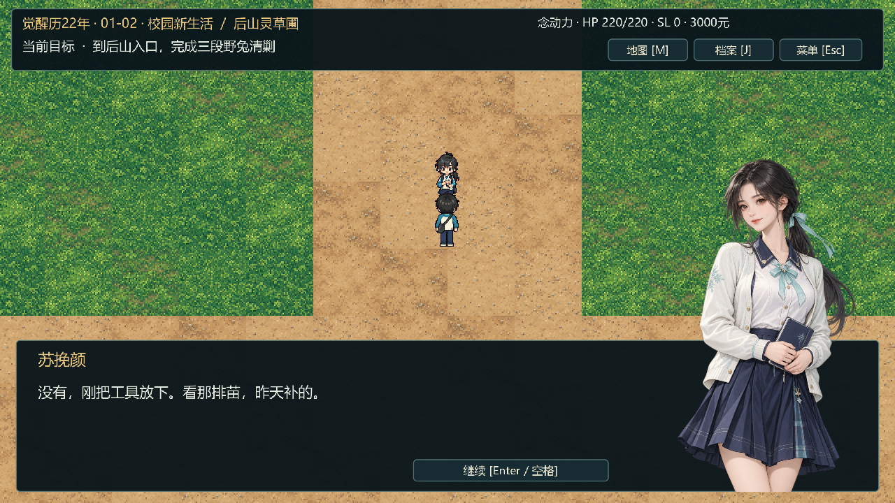

# 人物立绘接入与验收 · 2026-10-18

首章、章节前养成和第二章的33个发言角色已接入独立2D立绘。人物对白在右下角显示膝上立绘，文字和继续按钮在左侧；旁白、系统提示、选项与探索模式收起立绘。移动与战斗继续使用原有像素小人。



## 美术与资源

全部图片使用内置ImageGen逐人生成。先确定苏挽颜的精细墨线、水粉厚涂与现代校园服装画风，再制作同组人物；温若水与唐半夏追加面部年龄校正，初稿也保留。没有使用《逸剑风云决》的原角色图或素材。

- 当前覆盖33个发言身份，另有2张年龄修订前的原始图；运行图片33张，均为768×1152 RGBA。
- 角色设定、原图、最终提示词、像素身份参考和SHA256在[立绘目录](../assets/portraits/README.md)及[人物索引](../data/portraits/characters.json)。
- 温让圆胖体型、凌未央粉发、白沐瑶白发与左蓝右紫异色瞳、苏晚棠运动裤及导师的年龄与辨识物已逐图检查。
- 原有世界美术1035个文件逐项SHA256对比一致。未修改角色移动帧、地图地表、碰撞、剧情台词、分支收益与战斗数值。

## 接入实现

`chapter_portraits.gd`以发言名查询data中的索引，惰性加载并缓存纹理。`chapter_one.gd`统一使用该索引，覆盖两章与养成奇遇，取消将像素帧放大作为头像的旧查找。

`chapter_hud.gd`在1920×1080逻辑UI中将立绘放在对话面板右下，常规显示480×720，保持2:3比例，允许伸出对话框上沿。图片不接收鼠标，文本与继续按钮分别计算可用宽度；没有人物时恢复全宽正文。窗口沿用既有自适应逻辑。

后山教学弹层在右下使用同一张苏挽颜立绘；指令战斗时随弹层收起，保留战场与按钮。立绘使用线性采样，世界仍为最近邻与整数缩放。没有手工修改project.godot、导出预设、已有.import或引擎缓存。

## 验证结果

| 验证 | 结果 |
|---|---|
| 实际台词提取、33人纹理与透明度、布局及移动，源码headless | 643/643 |
| 源码真实GPU窗口，同样覆盖全部33个发言人 | 673/673 |
| 最终嵌入PCK的Windows EXE，由同版本Godot挂载，headless | 647/647 |
| 同一最终PCK真实GPU窗口 | 677/677 |
| 首章原有流程回归 | 210/210，20条完整章节分支 |
| 第二章原有流程回归 | 625/625，40条完整分支 |
| 自由养成回归 | 81/81 |
| 人物奇遇回归 | 161/161 |
| 原有世界美术哈希 | 1035/1035一致 |
| 独立Release EXE，从无工程文件的目录启动 | headless与GPU均退出0，章节Ready，无脚本错误 |

使用Godot 4.7.2 / Compatibility，实机GPU为NVIDIA GeForce GTX1650。窗口检查包含960×540、1280×720、1600×900、1920×1080、1920×1001、1920×1200、2560×1080、960×1080，以及原生最大化和全屏。超出物理屏幕的尺寸属于渲染窗口模拟。

检查包含：33张图逐人显示、中文正文容纳、继续按钮不被遮挡、旁白清除上一人物、选项与探索无残留、像素帧仍可移动、对话时保持移动锁、教程立绘及战斗时收起。测试使用独立测试状态与存档名。照片样例中为验收目的直接设置场景和当前发言，完整流程另由原有回归验证。

导出包额外确认：读取project.binary，未借用松散project.godot；人物索引SHA256与最终源码一致；33张运行图随包加载；生成原图未进入运行包。正式Release模板不接受外部脚本覆盖，因此自动化由同版本Godot挂载最终EXE中的PCK执行，EXE自身另做独立启动。

报告：[源码窗口](previews/portraits-2026-10-18/validation-report.json)、[源码headless](previews/portraits-2026-10-18/validation-headless.json)、[最终PCK窗口](previews/portraits-2026-10-18/export-validation-report.json)、[最终PCK headless](previews/portraits-2026-10-18/export-validation-headless.json)。

预览：[全部人物](previews/portraits-2026-10-18/portrait-contact-sheet.png)、[白沐瑶](previews/portraits-2026-10-18/dialogue-bai-mu-yao.png)、[温让](previews/portraits-2026-10-18/dialogue-wen-rang.png)、[唐半夏](previews/portraits-2026-10-18/dialogue-tang-ban-xia.png)、[苏父](previews/portraits-2026-10-18/dialogue-su-father.png)、[后山教程](previews/portraits-2026-10-18/tutorial-su-portrait.png)、[像素移动](previews/portraits-2026-10-18/pixel-world-movement.png)。

## 维护与发布

从Game目录运行：

```powershell
python -X utf8 tools/process_dialogue_portraits.py --preview
& $Godot --headless --path . --editor --import --quit
& $Godot --headless --path . --script res://tests/dialogue_portraits_visual.gd
& $Godot --path . --script res://tests/dialogue_portraits_visual.gd
& $Godot --headless --path . --export-release 'Windows Desktop' builds/windows/XinhaiFengyun.exe
python -X utf8 tools/package_release.py --version preview-2026-10-18-portraits --stage .dev/github-source
```

所有资源与索引编辑完成后再导出，并核对最终包索引；打包以后再变动索引需要重新导出。源码继续使用独立发布快照，保留原Game/.git历史，不提交.godot和构建目录。Windows包、完整源码ZIP、构建清单与SHA256使用新标记`preview-2026-10-18-portraits`，保留2026-10-02历史版本。GitHub仓库为[linbainian/xinhai-fengyun](https://github.com/linbainian/xinhai-fengyun)。

本记录验收立绘接入与发布包；M2一小时人工连续体验和最终平衡按原计划另行验收。
