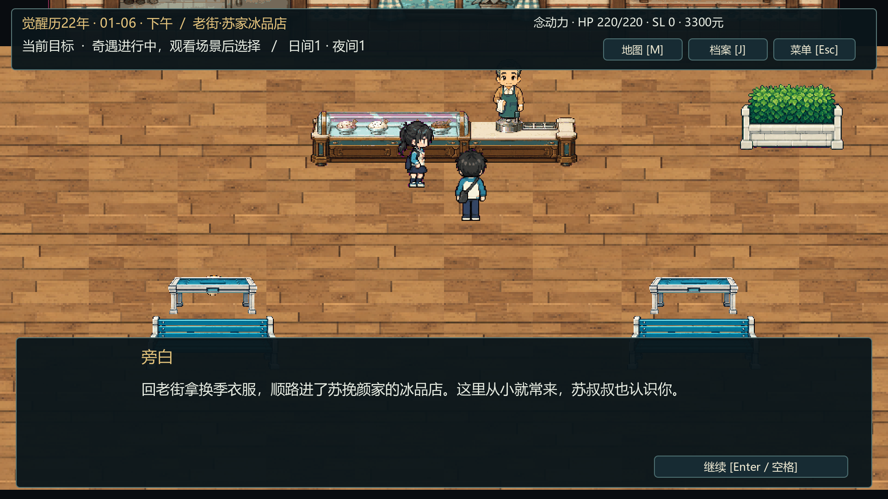
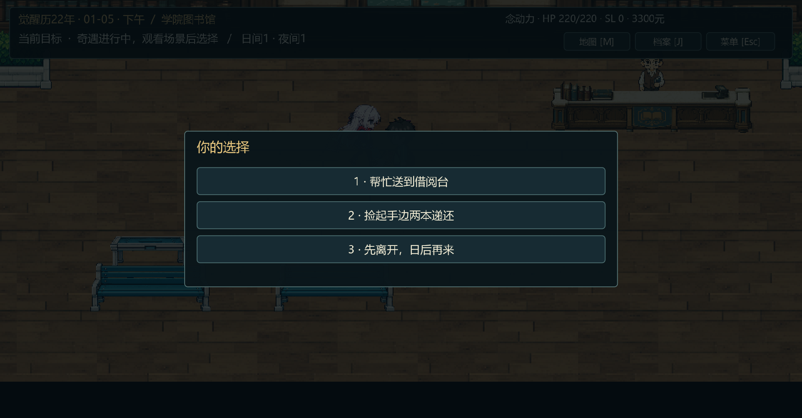

# 奇遇自动触发与第二章台词修订

更新：2026-10-01。依据用户“台词像人机、文青味重”和“奇遇应自动播放场景，再做选择”的反馈完成。Godot 4.7.2 / Compatibility，GTX 1650。

## 游玩方式

运行工程，进入01-04自由养成；已有首章归档可从标题选择“首章完成档 · 从1月4日养成”。按C→闲逛，选地点。满足日期/前置条件时，游戏直接切到奇遇场景、播放人物入场和镜头，随后显示对白。Enter/空格继续阅读，读完后用数字键或鼠标做选项。十一种奇遇都不再要求玩家走近人物按E。

人物奇遇仍开放至01-14；01-15进入第二章复筛。原六种事件的日期与后续开放规则沿用原设定。出发消耗1日间行动，选择不再扣行动。“先离开”不计完成，符合条件时以后仍可遇到。

## 台词

- [人物奇遇作者稿](../../策划与剧情/养成人物奇遇实装台词_v0.1.md)：19片段、115句，包含冰品店、送书、冰雷对练、午休加练、楼道传单及各分支。
- [第二章作者稿](../../策划与剧情/第2章实装台词脚本_v0.1.md)：95片段、253句，包含自由养成介绍、原六奇遇、复筛、日程/社团/同行、港口与结算。

两份稿件全部逐场改写。学生先按熟悉程度打招呼，围绕手上的书、饭团、药、表单和任务说话；旁白交代可见事实，去掉抒情收尾与刻意接梗。温让随意，白沐瑶简短，苏晚棠好胜，林初夏温和；唐半夏、韩烛、秦妖妖按当下职责交代事情。

例如，图书馆初见先处理掉落的书，再互通姓名；复筛结束有道谢和告别；打包冰品的对白在店内完成，不提前插入宿舍温让的回应。养成期日常对白不再引用尚未发生的复筛。江北辰左腕编号、统计学观察对象、双章封存、S回执“与上月17号样本……”仍保留。

两份作者稿均通过各自导入器先备份再导入，运行JSON与Game/docs可读副本已同步。首章台词不在本次修订范围。

2026-10-01追加旁白人称修订：按用户示例，奇遇6句、第二章18句共24句旁白省去重复的“你/你们”主语，直接叙述场景与动作，不机械改成“林大”。“苏叔叔也认识你”这类关系信息保留，角色对白沿用原文。两份稿件片段ID及句数保持；写作口径已同步剧情卷§0.5与AGENTS。

冰品店：“回老街拿换季衣服，顺路进了苏挽颜家的冰品店。这里从小就常来，苏叔叔也认识你。”

图书馆：“在图书馆拐角撞上一个女生。包带刮到她抱着的书，两本掉在地上。她脖子上系着一条红围巾。”

## 自动演出与存档

十一种事件统一为“闲逛出发→自动入场→对白→选项→结果演出/对白→养成面板”。新增原六事件的入场走位后，养成演出共16段：十一入场、五选择。即使下一事件仍在同一张训练场地图，也会刷新当次演员与物件。

入场结束会自动保存待选状态。继续游戏直接恢复选项和最终人物站位，不重复播放入场；旧档中尚未入场的事件自动补播。资金或券不足时提示原因，再回到原选项，不扣钱券、不发收益。Esc跳过入场仍停在选项，收益由有效选择结算一次。

外层`chapter1.1`、日历`chapter2-prototype.2`、成长`cultivation.1`保持。全部十一事件的定义、日期、前置、选项和收益与本次修改前备份逐项一致。测试使用独立存档，不覆盖玩家正式进度。

## 本次实测

旁白人称修订另已核对：24处差异全部为旁白文本，片段ID、顺序、句数与所有角色对白保持；两份作者稿和运行JSON一致。资源/正文检查重新通过2196/2196、697/697；冰品店及图书馆实际显示更新旁白，两处截图已替换。差异报告`.dev/narration-subject-integrity-report.json`，实机预览日志`.dev/narration-subject-preview.log`，退出码0，无ERROR/WARNING。

下表完整键鼠流程、规则与存档报告来自此前自动触发/口语修订批次；本次旁白调整沿用该流程，另执行上述文本核对与两处实机预览。

| 检查 | 结果 | 本地报告 |
|---|---|---|
| 人物奇遇条件、两种结果、钱券、上限、防重、存档与宿舍流程 | 161/161 | `.dev/encounters-smoke-report.json` |
| 作者稿同步、素材来源、碰撞及16段演出路径 | 2196/2196 | `.dev/encounters-assets-report.json` |
| 实际键鼠：十一奇遇自动入场、五事件读档恢复选项与站位、同图新事件、余额不足、旧待入场档、跳过/离开 | 1282/1282，74.954秒 | `.dev/encounters-visual-report.json` |
| 十一事件定义与修改前备份逐项比较 | 11/11一致 | `.dev/auto-encounters-event-definitions-report.json` |
| 养成行动/成长/突破与任务规则 | 81/81 | `.dev/cultivation-smoke-report.json` |
| 实际面板→奇遇检查点读档→选择→委托→01-15复筛，多窗口布局 | 746/746，27.495秒 | `.dev/cultivation-visual-report.json` |
| 第二章五系/四导师、单人/四人、两任务路线/两风暴选择/三线索去向 | 625/625，40条完整分支 | `.dev/chapter2-smoke-report.json` |
| 实际养成→复筛→走廊招募→四人两战→线索→S结算与读档 | 320/320，65.692秒 | `.dev/chapter2-visual-report.json` |
| 第二章作者稿/运行文本、素材、地图通路 | 697/697 | `.dev/chapter2-assets-report.json` |
| 首章规则回归 | 210/210，20条完整流程 | `.dev/chapter1-smoke-report.json` |
| Godot最终资源导入、脚本注册与本次三条GPU日志 | 退出码0，无ERROR/WARNING | `.dev/auto-encounters-import-final.log`及本次GPU日志 |

已查看Godot实际对白、选择与场景截图。快速输入检查证明运行路径、文本布局和状态结算；M2的一小时人工阅读体验与最终数值平衡仍未验收。

## 维护

规则已同步[剧情卷v0.3.9](../../策划与剧情/觉醒者档案新海风云_剧情卷_v0.3.md)、[自由养成实施补充](../../策划与剧情/章节前自由养成实施补充.md)、[第二章实施补充](../../策划与剧情/第2章可玩流程实施补充.md)、AGENTS与交接文档。改台词先改策划目录作者稿，再导入；禁止旧运行JSON覆盖作者稿。

主要实现：`chapter_cultivation.gd`负责自动接入和有效选项结算，`chapter_one.gd`负责切图/对白/选项与读档续接，`chapter_cinematics.gd`恢复演出最终站位，`build_encounter_maps.py`维护16段养成演出。日期与收益仍由既有配表控制。

在Game目录使用本机Python运行`tools/import_encounter_script.py`、`tools/import_chapter_two_script.py`核对；`--apply`先备份再写运行数据。GPU验收依次运行`tests/encounter_visual.gd`、`tests/cultivation_visual.gd`、`tests/chapter2_visual.gd`。完整命令见[人物奇遇验收](人物奇遇与宿舍场景验收.md)。本次前置备份在`.dev/backups/before-auto-encounters/`，台词备份在`encounter-script/`和`chapter-two-script/`。
