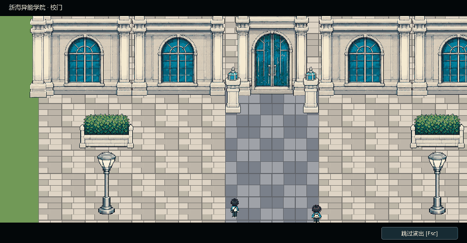

# 第1章同行与登场演出

2026-10-01。交接中的四项需求、窗口适配、大会场与检测礼堂修正完成后，追加首日的JRPG转场。Godot打开本工程按F5，从标题开始新游戏即可体验。

## 已接入的演出

同日追加：后山→操场三处招新摊位、与温让同行回寝室、寝室门双向换到共用走廊、林初夏走近初见、交谈后沿楼道离开，新增6段，首章共11段。领取传单后可以继续逛摊位，再明确选择一起回宿舍。林初夏的登场发生在走廊；回屋之后才能睡觉。首章作者稿现61片段/244句，地图现16个地点；新增室内演出使用2倍整数镜头，原首日大场景演出保持1倍。新版预览与维护见[人物奇遇与宿舍场景验收](人物奇遇与宿舍场景验收.md)，下文五段首日动画保留。

| 演出 | 实际行为 |
|---|---|
| 校门抵达 | 林大与温让从南侧步行来到学院校门，站定转身后接原报到闲聊 |
| 进入检测礼堂 | 两人走向入口，淡出换场，再沿室内过道一起走到检测区 |
| 检测后到大会场 | 同行离开检测礼堂、进入大会场，在台下停下；四导师从画面右侧入场，沿中央台阶依次登台，显示肖像、姓名和山头/职务 |
| 导师介绍后去展区 | 四位导师站定轮流介绍，接温让的姑姑话题；两人步行离场、换到导师展区，开放原有四个任务 |
| 拜师后苏挽颜来访 | 正式拜师对话结束后，林大与温让走到展区中央；苏挽颜从右侧通道走来，停下转身，完整问候和谈话后发布明早后山委托 |

温让在首日探索中沿主角走过的路线跟随；近距离办事交互优先考官、导师及物品。六位出场人物各有四向16帧，行走时切帧，停下后面对交流对象或观众。

转场采用平滑移镜、淡出/淡入、登场姓名条。演出相机临时用1倍整数倍率展示建筑和路线，结束回到2倍探索/对白相机；人物源帧、最近邻和窗口独立适配保持原约定。主席台对白按导师与两位学生重新取景。

## 实际运行预览

以下GIF由Godot真实GPU画面采样导出，约33秒，包含五段演出。预览省略玩家逐句阅读时间；游戏内对白仍由Enter/空格推进。



- [导师登台片段](previews/test_to_assembly.gif)
- [校门抵达](previews/gate_arrival.gif)
- [苏挽颜来访](previews/su_arrival.gif)

## 跳过与存档

演出中移动、地图和存档输入锁定；点击右下“跳过演出”或按Esc，仍应用同一组路点终点、换场和后续对白。F11在演出中可用。剧情结果只提交一次，反复跳过不会重复加导师收益或好感。

返回标题、重开游戏立即取消旧演出和回调。新档的初始校门检查点读档会重新走抵达；原来的检测礼堂旧档可正常续玩，无需重新报到。原首章存档版本 `chapter1.1` 保留，HP/SL、导师任务与奖励、三种委托态度和三天日期推进按既有规则。

## 维护入口

- `scripts/chapter/chapter_cinematics.gd`：顺序演出器、角色路径、镜头、淡出与姓名条、跳过和取消。
- `scripts/chapter/chapter_actor.gd`：六位NPC的四向行走与朝向。
- `scripts/chapter/chapter_map.gd`：角色查询、脚印路线跟随与交互。
- `data/chapter1/cutscenes.json`：五段演出的时间、路线、镜头、落点、姓名条。
- `data/chapter1/maps.json`：13个地点，新增 `gate` 与 `assembly_stage`；地图仍由独立地砖、物件、碰撞和角色组成。
- `assets/chapter1/cinematics/`：六张ImageGen源图、提示词、96帧、QC和哈希清单；新行走帧匹配原NPC身高和脚底线。

改对白先编辑工程外的 `策划与剧情/第1章实装台词脚本_v0.1.md`，再用 `tools/import_chapter_script.py --apply` 安全导入。当前53片段、221句正文，新增 `mentor_entrance`；四导师介绍不影响原任务资格。源稿与剧情卷、实施补充已同步。

有意重新组装地图时，在Game目录依次运行 `tools/assemble_hall_map.py`、`tools/build_chapter_cinematics.py`、`tools/build_chapter_two_maps.py`，最后运行 `tools/build_encounter_maps.py`，恢复本轮三摊位、寝室/走廊与人物事件。旧工具会重写cutscenes；手调路点前先保留备份。

```powershell
& 'C:\Users\l\Downloads\Godot_v4.7.2-stable_win64_console.exe' --path . --disable-vsync --max-fps 60 --script res://tests/chapter1_cinematics_visual.gd
& 'C:\Users\l\.cache\codex-runtimes\codex-primary-runtime\dependencies\python\python.exe' tools/export_cinematic_preview.py
& 'C:\Users\l\.cache\codex-runtimes\codex-primary-runtime\dependencies\python\python.exe' tools/reproduce_cinematic_art.py --processor 'C:\Users\l\.agents\skills\generate2dsprite\scripts\generate2dsprite.py'
```

首章完整GPU流程353/353通过；演出专项1385/1385通过，984个实际角色走位采样避开墙体/家具，另有119个跟随采样检查温让绕过主席台拐角。覆盖六位角色切帧、导师顺序、输入恢复、跳过、取消、旧档及F11。四导师×三种委托回应、规则、分辨率和资源检查详见[第1章验收记录](第1章验收记录.md)。

本次修改前代码/作者稿备份在 `.dev/backups/before-chapter-cinematics/`。原资源文件没有移动，未手改引擎缓存或资源import，也没有创建Git提交。
