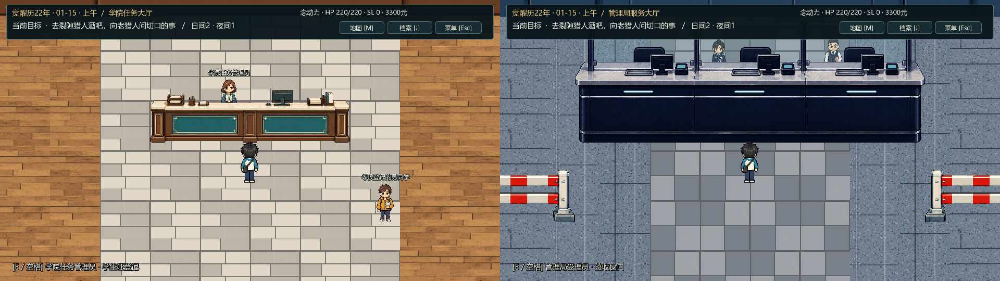
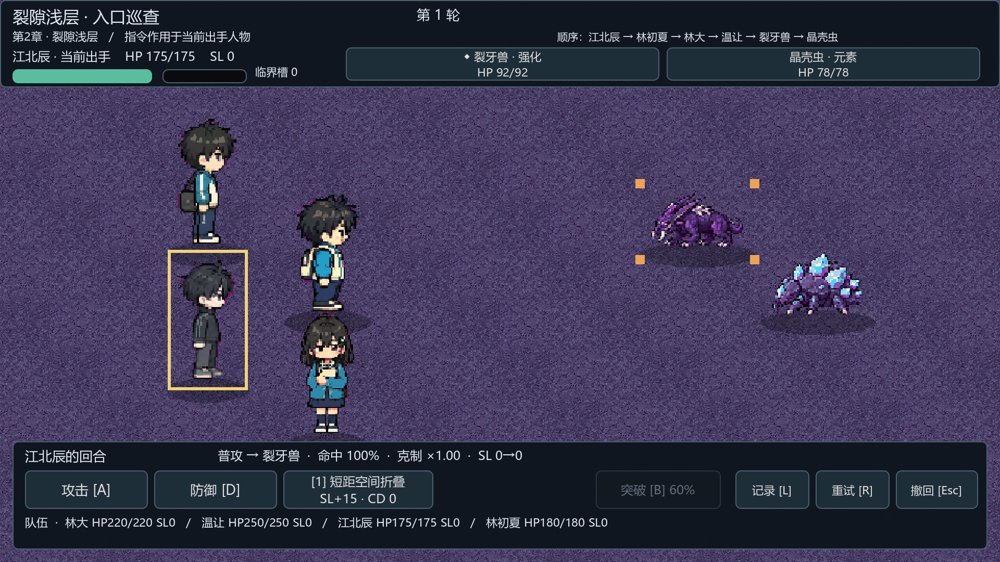
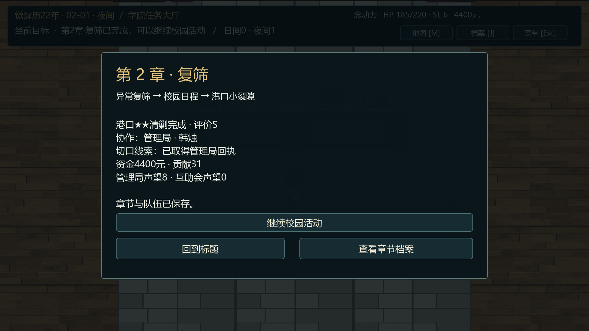

# 第2章《复筛》首版可玩流程与大厅美术

更新：2026-10-01。引擎 Godot 4.7.2 / Compatibility，实机 GTX 1650。首章结束先进入01-04自由养成，01-15再触发第2章复筛，当前可玩到港口★★清剿结算。日历版本 `chapter2-prototype.2`；成长和面板详见[自由养成验收记录](自由养成验收记录.md)。

## 进入和游玩

2026-10-01本轮宿舍与人物奇遇更新：林初夏从寝室移到独立共用走廊，可在寝室房门按E出去找她，再回房睡觉。复筛后的同行/夜谈规则保留；本轮实机已从01-04养成，经01-15复筛、走廊招募到港口两战与S结算，320/320通过。新增五个01-14前人物奇遇及场景预览见[人物奇遇与宿舍场景验收](人物奇遇与宿舍场景验收.md)。

1. 用 Godot 打开 `Game/project.godot`，按F5。已有首章结束存档的玩家选“继续游戏”，结束页点“进入自由养成 · 1月4日”。新档正常完成首章后进入。C面板自行安排01-04—01-14修炼、闲逛奇遇、赚钱委托和生活，睡眠推进日期；五系、导师、资金、贡献、好感和首章记录保留。
2. 01-15宿舍和温让看复筛通知，M打开地图前往医务室。找唐半夏完成复筛，查看名单与封存箱，再找她确认归档。林初夏与江北辰同场，名单和双章封存保留后续伏笔。
3. 去社团活动室登记剑道、元素研究、治愈或暂不入社，也可在01-04自由养成期先登记。上课、修炼、社团、帮忙任务和休息每次消耗1日间行动点；上午、下午各一次，夜间可安排一次。宿舍床铺睡觉推进一天，也可沿用课表执行最多7天，略过可选夜间社交，遇01-15复筛提前停止。修炼属性、技能熟练与觉醒度会实际影响第二章战斗。
4. 好感达到20、行动等级差不超过2时，可约温让、江北辰、林初夏同行，最多主角加3名同伴。江北辰上午勤工，林初夏下午有社团排班，改到其他时段邀请。温让沿用首章好感；复筛后江北辰15、林初夏20，江北辰夜谈一次即可达标。
5. 到02-01且至少完成一次周结算后，去学院任务大厅接港口★★委托。管理局路线初遇韩烛，互助会路线初遇秦妖妖。两人都是B级驻守协作人员，当前D级新生不能邀请他们入队。接任务需要尚有日间行动点；夜间可睡到明早再接。
6. 赴港口，找联系人登记进裂隙；本次登记占用当天剩余日间时段。浅层按入口异兽→岩壁风暴选择→残骸区异兽→尸体切口拍照推进。深层暂时封锁。两场是真实回合制战斗，同伴分别操作，连续携带HP/SL；战场有普攻、技能、受击、防御和突破效果。
7. 切口照片可上交管理局、去猎人酒吧问老猎人，或自己保留。相应回执、声望和情报去向写入档案。回学院任务大厅交任务，获得A/S评价和奖励。本章结束页可继续校园活动，第3章入口尚未接入。

键位沿用首章：WASD/方向键移动，E/空格互动，Enter推进，数字1–4选项，M地图，J档案，C日程养成，Esc菜单，F5/F9存读档，F11全屏，演出中Esc跳过。裂隙战斗用A攻击、D防御、1/2技能、Tab选敌、B突破、L记录；鼠标按钮可用。林初夏以被动预知和闪避表现能力，当前使用普攻、防御，没有新增主动精神伤害技能。

## 两处大厅与新场景

学院任务大厅与管理局服务大厅不再复用同一组墙体、柜台与人物。

| 学院任务大厅 | 管理局服务大厅 |
|---|---|
| 奶油色墙面、木地板、青绿木质服务台 | 蓝灰墙体、工业地砖、三联服务窗口 |
| 学生登记、社团值日生、设施员及候办学生 | 受理员、执勤员、档案员及候办市民 |
| 两侧长椅、植物、中央学生通道 | 入口队列隔栏、等候区、透光窗口 |

柜台与人物分别定位，工作人员站在柜台后，玩家在前台交互；窗口玻璃使用独立材质保持工作人员可见。物件保持正向，地表、建筑组件、角色、碰撞和交互点独立维护。新增宿舍、医务室、教室、训练场、社团、港口、裂隙、猎人酒吧8张地图；原10段镜头/移动/淡入淡出演出之外，追加寝室与共用走廊的两段进出演出，现12段。







预览均来自Godot真实渲染截图。大厅对照为两张截图缩小并排；游戏加载各独立组件。全景截图用于检查布置，正常探索相机仍为2倍。

## 进度与重试

主存档仍使用 `user://saves/chapter1.json` 与 `chapter1.1` 外层版本，新增第2章及成长字段。首章旧档支持；开始01-04养成前另存 `chapter1-chapter1-cleared.json` 首章完成档，归档失败时停留原结束页并显示原因。已在第二章的旧档保持当前日期/剧情和原周起点，补成长数据并迁移本周帮忙账本；正式继续读取主槽，不自动倒退到养成开始。

副本每场开始前保存，失败可用当前遭遇开场状态重试，也可退出后回港口急救。尚未获胜遭遇不会写入战后HP/SL；已清理遭遇和调查不会丢失。倒地同伴在下一场不参战，风暴不会使其复活，港口补给可恢复。队伍获胜而主角倒地时，探索以1HP恢复，并记录倒地；突破增加的临时HP上限在战后归回基础上限。读档保留秦妖妖/韩烛已到场的位置，完成的登场演出不重复播放。

任务、线索声望、周结算和本周帮忙奖励均只结算一次。S评价条件为进入掩体避过风暴、完成拍照、已获胜遭遇无倒地记录且未中途撤离；S回执带有“与上月17号样本……”残句。年度日历目前截至12-31，禁止越界睡觉或推进一周，后续年度调度尚未接入。

2026-10-01最新台词与触发修订：全部奇遇和第二章实装台词改为日常口语，闲逛奇遇自动演出后给选项，读档续接选项。作者稿、差异和本轮证据见[奇遇自动触发与台词修订](奇遇自动触发与台词修订.md)。下表奇遇/养成/第二章主流程为本次重跑，未改的首章GPU、归档、战斗保护与路线专项保留此前基线。

## 实测结果

| 验证 | 结果 | 证据 |
|---|---|---|
| 第2章规则、日历、好感、真战斗、奖励、存档 | 625/625；40条完整分支 | `.dev/chapter2-smoke-report.json` |
| 鼠标/键盘通关：首章完成档→01-04养成→01-15复筛→4人队伍→两战→管理局回执→S结算→存读档 | 320/320；65.692秒快速输入，包含走廊招募 | `.dev/chapter2-visual-report.json` |
| 战斗窗口适配、真实Timer败北、鼠标重试、退出、演出跳过与取消 | 33/33 | `.dev/chapter2-guards-report.json` |
| 秦妖妖登场/落点读档、酒吧真实交互、互助会声望与A结算 | 56/56 | `.dev/chapter2-route-report.json` |
| 作者稿/运行文本一致、素材来源、透明/调色板/脚底、碰撞通路及十一个动态奇遇 | 697/697 | `.dev/chapter2-assets-report.json` |
| 01-04起自由养成规则、实际面板输入/多窗口与标题归档入口 | 81/81、746/746、11/11 | `.dev/cultivation-smoke-report.json`、`cultivation-visual-report.json`、`cultivation-archive-report.json` |
| 新素材保留原图重新处理 | 14份原图，79张运行PNG哈希完全一致 | `.dev/playable-art-reproduction.json` |
| 第一章规则回归 | 210/210；20条流程 | `.dev/chapter1-smoke-report.json` |
| 第一章键盘/鼠标完整回归 | 394/394；112.980秒 | `.dev/chapter1-visual-report.json` |
| 第一章文本/资源回归 | 612/612 | `.dev/chapter1-assets-report.json` |
| 10张地图与两处柜台实际GPU截图 | 12张已查看 | `.dev/chapter2-overview-*.png`、`chapter2-desk-*.png` |

规则分支覆盖五系、四导师、单人/四人队伍、两种委托、两种风暴处理及三种线索去向。四人战斗另验960×540、1280×720、1920×1080、1100×900，全部角色位于状态栏与指令栏之间。所有输入验收用独立 `.dev/` 存档，未改玩家正式进度。

## 维护入口与重跑

- 剧情依据：[剧情卷第2章](../../策划与剧情/觉醒者档案新海风云_剧情卷_v0.3.md)、[第二章实施补充](../../策划与剧情/第2章可玩流程实施补充.md)。
- 作者稿：[第2章实装台词脚本](../../策划与剧情/第2章实装台词脚本_v0.1.md)，95片段、253句。`tools/import_chapter_two_script.py` 默认检查，`--apply` 先备份再导入 `data/chapter2/dialogues.json`，可读副本只写 `docs/第2章台词脚本.md`。
- 规则与配表：`scripts/chapter/chapter_two_calendar.gd`、`chapter_two_story.gd`、`data/chapter2/settings.json`。
- 实战：`chapter_rift_battle.gd`、`chapter_rift_hud.gd`、`chapter_rift_arena.gd`；入口 `scenes/chapter/chapter_rift_battle.tscn`。
- 地图及演出：`data/chapter2/maps.json`、`cutscenes.json`。`tools/build_chapter_two_maps.py` 重建第2章8图及首章hall/cbd两项；重跑旧首章地图构建器后，要再运行此脚本恢复大厅，最后运行`tools/build_encounter_maps.py`恢复本轮寝室/走廊、招新与奇遇地图。
- 新美术处理与来源：[大厅素材](../assets/venues/README.md)、[第2章素材](../assets/chapter2/README.md)。

在Game目录执行：

```powershell
$engine = 'C:/Users/l/Downloads/Godot_v4.7.2-stable_win64_console.exe'
$py = 'C:/Users/l/.cache/codex-runtimes/codex-primary-runtime/dependencies/python/python.exe'
$env:PYTHONIOENCODING = 'utf-8'
& $py tools/import_chapter_two_script.py
& $py tests/chapter2_assets.py
& $engine --headless --path . --fixed-fps 60 --script res://tests/chapter2_smoke.gd
& $engine --path . --disable-vsync --max-fps 60 --script res://tests/chapter2_visual.gd
& $engine --path . --disable-vsync --max-fps 60 --script res://tests/chapter2_guards_visual.gd
& $engine --path . --disable-vsync --max-fps 60 --script res://tests/chapter2_route_visual.gd
& $engine --path . --disable-vsync --max-fps 60 --script res://tests/chapter2_art_visual.gd
```

GPU命令依次运行，使用真实Timer。缺少导入资源时先由Godot执行 `--headless --editor --import --quit`；不要手动改 `.godot` 或 `.import`。

## 当前范围

这是第二章第一版可玩代码，已经实现章节前自由养成、首批六维派生/技能熟练、安全D→C突破、日程/周结算、三位可邀同伴、港口浅层副本和剧情分流。M2的“从新档连续玩≥1小时”尚未实测达标，快速输入测试不能代替阅读节奏与人工长期试玩。最终数值平衡、完整技能树/六维映射、通用年度事件池、同伴个人线、深层裂隙及第3章继续待开发。

本次前置备份在 `.dev/backups/before-chapter-two/`，台词逐次导入在 `.dev/backups/chapter-two-script/`。无Git提交；用户原有 `scenes/main.tscn` 与 `docs/M0开发计划.md` 改动保留。
