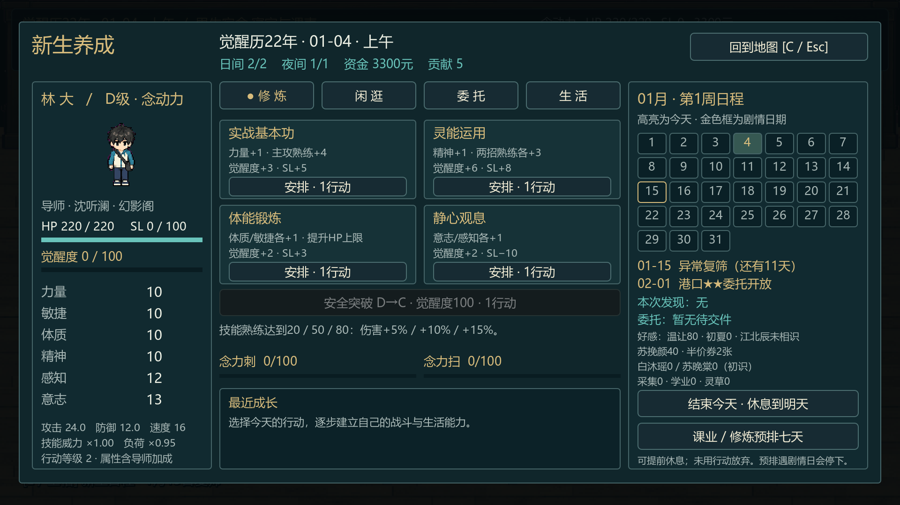
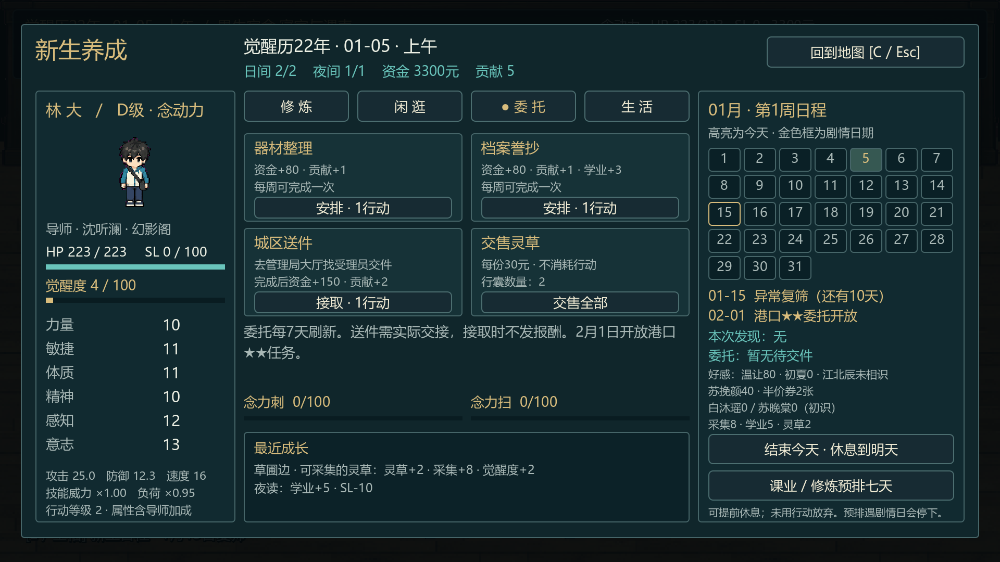

# 首章之后 · 自由养成与角色面板

更新：2026-10-01。Godot4.7.2 / Compatibility，GTX1650实机。按用户确认：首章保留1月1—3日，1月4—14日自由养成，1月15日自动触发第二章复筛。已实装代码和原生Godot面板，收益应用于第二章实际战斗。

## 如何游玩

2026-10-01人物事件追加已接入：五处闲逛、共11事件，原六事件之外新增苏家冰品店、白沐瑶送书、苏晚棠/白沐瑶对练、午休加练、林初夏楼道传单。新人物事件只开放至01-14，有实际地图、行走、物件镜头与冰雷演出。原有日期、行动和成长数字保留。最新预览、存档说明与本轮验证见[人物奇遇与宿舍场景验收](人物奇遇与宿舍场景验收.md)；下表为本轮回归后的养成/章节报告，新增人物事件专项见上方链接。

1. Godot打开 `Game/project.godot`，F5运行。完成首章或继续首章完成档，在结算页点击 **进入自由养成 · 1月4日**。进入前自动归档首章，之后显示养成介绍和面板。已有归档时，标题显示 **首章完成档 · 从1月4日养成**，可直接进入新增流程，无需重玩首章。
2. 按 **C** 打开/关闭日程面板。修炼页可选实战基本功、灵能运用、体能锻炼、静心观息，分别提升属性、独立技能熟练和觉醒度。觉醒度100后可尝试安全D→C突破。
3. 闲逛页可去学院、训练场、后山、商业街、宿舍共用楼道。选择闲逛后，符合日期/前置的事件自动切场、播放入场，再阅读对白并做选项；十一种事件均无需找人按E。结束入场时自动保存，继续游戏直接显示待选项，恢复相同人物站位。钱券不足会提示后回到选项；“先离开”结束本次发现。
4. 委托页可做器材整理、档案誊抄，或接城区送件。送件需M去管理局服务大厅，找受理员按E交件，之后发报酬。灵草可以出售；同类周工作共用一个账本，每7天刷新。
5. 生活页可以上课、调息、夜读、和温让夜谈、使用灵草或研读笔记。每日2次日间行动、1次可选夜间安排；行动用完后进入夜间，睡觉进入次日。可提前休息，未用机会会放弃。
6. “课业/修炼预排七天”依正常规则执行，遇1月15日会提前停止。复筛通知自动演出，未完成检查不能跳过；复筛结束后继续同一套养成，属性、熟练、物品和资金进入第二章战斗，2月1日开放港口★★任务。

普通移动和交谈不扣行动。存读档F5/F9、地图M、档案J、菜单Esc、全屏F11沿用。成长不增加MP。





以上为Godot直接截图，保留真实UI和像素角色。面板是矢量控件；世界、UI继续各自缩放，960×540小窗口至2560×1080宽屏和1000×900竖向窗口均已验证。分页卡片、描述、按钮与最近成长的滚动区已经检查边界和相互遮挡。

2026-10-01最新台词与触发修订：全部奇遇和第二章实装台词改为日常口语，闲逛奇遇自动演出后给选项，读档续接选项。作者稿、差异和本轮证据见[奇遇自动触发与台词修订](奇遇自动触发与台词修订.md)。下表奇遇/养成/第二章主流程为本次重跑，未改的首章GPU、归档、战斗保护与路线专项保留此前基线。

## 实测

| 验证 | 本轮结果 | 报告 |
|---|---|---|
| 养成日期、行动、六维与技能实际入战、安全突破两结果、六个事件各两选择、任务防重、存档/旧档迁移 | 81/81 | `.dev/cultivation-smoke-report.json` |
| 真实鼠标/键盘：首章结束→面板→体能→后山奇遇自动入场→选项检查点读档→选择→夜读→送件→存读档→预排停在15日→复筛→再开面板→标题读取首章归档；多窗口尺寸、控件边界 | 746/746，27.495秒快速输入 | `.dev/cultivation-visual-report.json` |
| 已有第二章主档→读取首章归档→另存现有二章进度→1月4日养成 | 11/11 | `.dev/cultivation-archive-report.json` |
| 第二章规则完整回归，五系/四导师、单人/组队、两路/两风暴/三线索、真战斗和存档 | 625/625，40条完整分支 | `.dev/chapter2-smoke-report.json` |
| 鼠标/键盘从首章完成档经01-04养成与01-15复筛至四人港口战斗、线索及S结算 | 320/320，65.692秒快速输入，包含走廊招募 | `.dev/chapter2-visual-report.json` |
| 第一章规则与完整真实输入回归 | 210/210、394/394 | `.dev/chapter1-smoke-report.json`、`chapter1-visual-report.json` |
| 作者稿与运行正文一致、原图来源、透明/脚底、场景通路和十一个动态奇遇的路径 | 697/697 | `.dev/chapter2-assets-report.json` |

检查使用独立 `.dev/` 存档，没有覆盖玩家正式存档。实际运行修正了分页期间释放正在发信号的按钮，以及描述/按钮的重叠；最终养成GPU运行无上述错误。快速自动输入不能证明一小时人工连续阅读体验或最终数值平衡。

## 存档与维护

外层版本继续 `chapter1.1`；日历 `chapter2-prototype.2`，成长 `cultivation.1`。首章旧档从1月4日新入口进入。已在第二章的旧档保持当前日期和阶段，补上成长字段，保留周起点及已领取任务记录，继续用C；不会自动倒退到1月4日。如需体验新增11天，标题选“首章完成档 · 从1月4日养成”。选择重玩前，当前养成/第二章主档另存为 `chapter1-before-cultivation-replay.json`，归档失败会保留现有进度；此后主槽跟随玩家选中的养成流程。没有首章归档时可开新游戏。

发现事件的ID/区域、入场已播标记、已结算列表、待交文件、接取周、完成账本、六维/熟练/觉醒度、行囊和最近记录一起保存。已入场奇遇直接恢复选项和最终站位；旧档尚未入场的奇遇自动补播。读档不会重抽发现或重复加导师奖励；无效属性、技能、日期、事件或奖励记录会被拒绝，当前状态保留。最新专项见[奇遇自动触发与台词修订](奇遇自动触发与台词修订.md)。

- 规则与数字：[章节前自由养成实施补充](../../策划与剧情/章节前自由养成实施补充.md)。
- 配表：`data/cultivation/settings.json`、`events.json`。
- 模型与面板：`scripts/chapter/chapter_cultivation.gd`、`chapter_cultivation_panel.gd`。
- 日历/入口/剧情：`chapter_two_calendar.gd`、`chapter_two_story.gd`、`chapter_one.gd`、`chapter_hud.gd`。
- 实际战斗：`chapter_rift_battle.gd`读取成长后的定义；M1灰盒和首章教程配表不改。
- 作者稿：[第2章实装脚本](../../策划与剧情/第2章实装台词脚本_v0.1.md)，95片段/253句；通过 `tools/import_chapter_two_script.py --apply` 备份再导入，可读副本为 `docs/第2章台词脚本.md`。

在Game目录重跑：

```powershell
$engine = 'C:/Users/l/Downloads/Godot_v4.7.2-stable_win64_console.exe'
$py = 'C:/Users/l/.cache/codex-runtimes/codex-primary-runtime/dependencies/python/python.exe'
$env:PYTHONIOENCODING = 'utf-8'
& $py tools/import_chapter_two_script.py
& $py tests/chapter2_assets.py
& $engine --headless --path . --script res://tests/cultivation_smoke.gd
& $engine --headless --path . --script res://tests/chapter2_smoke.gd
& $engine --path . --disable-vsync --max-fps 60 --script res://tests/cultivation_visual.gd
& $engine --path . --disable-vsync --max-fps 60 --script res://tests/cultivation_archive_visual.gd
& $engine --path . --disable-vsync --max-fps 60 --script res://tests/chapter2_visual.gd
```

GPU命令依次运行；先完成Godot资源导入，再启动画面验收。前置备份 `.dev/backups/before-free-cultivation/`，台词备份 `.dev/backups/chapter-two-script/`。未创建Git提交，原有M0改动保留，没有手工改 `.godot/`、`.import` 或移动已引用美术。

当前是首批六维派生与十一个地图事件的可玩养成；完整技能树、80熟练变式、制作/生活技能分支、年度通用事件、C级以上安全晋阶和最终平衡继续待开发。首章三天剧情、第二章核心事件及后续暗线按剧情卷v0.3.9。
